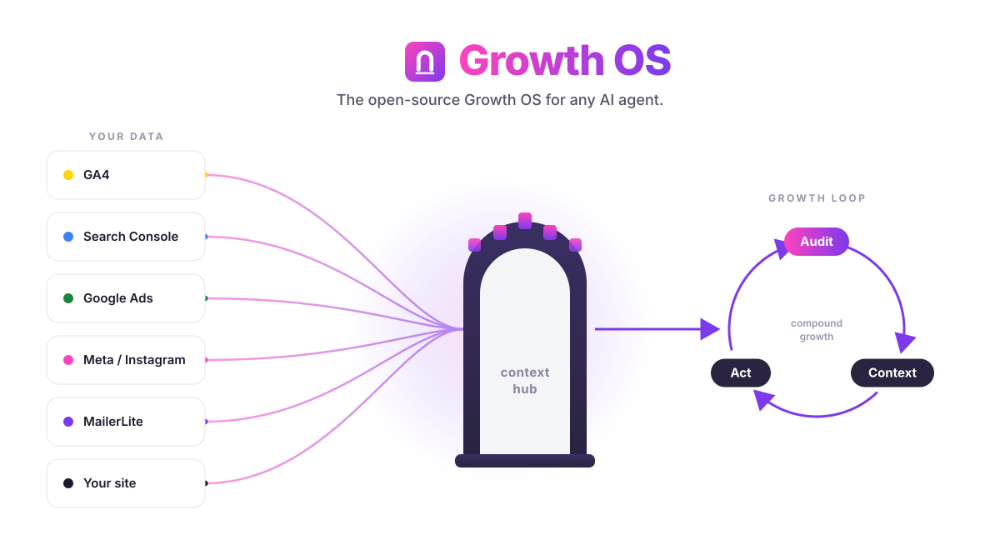

<div align="center">



# NoCodeWork Growth OS

**The open-source Growth OS for any AI agent.**

Give your agent a URL. It learns the business, audits growth end to end, wires up your real analytics accounts, and hands the work to focused marketing skills — with the context saved so it never asks twice.

[](LICENSE)
[](#what-it-does)
[](#runs-on-any-agent)
[](https://nocodework.io)

[Install](#install) · [Connect accounts](#connect-your-accounts) · [Using it](#using-it) · [How it works](#how-it-works) · [Compare](#how-it-compares)

</div>

---

## Why

I built Growth OS because I was tired of two things.

First, re-explaining my business to an AI on every task. Who the customer is, what the product actually does, why anyone buys it — I typed it out again and again. Second, every "growth AI" I tried was a chat that gave advice but never touched a real number. It couldn't see my Search Console, my GA4, or whether Google's own PageSpeed API thought my site was slow. So the advice was generic, and generic advice is worthless.

Growth OS fixes both. It extracts positioning from a URL once and writes it to a file your agent reads forever. Then it connects to your *actual* analytics accounts — read-only, your own keys — so every audit and every recommendation is grounded in your real data, not a vibe.

It's open source, MIT, self-hostable, and it runs on whatever agent you already use.

## What it does

Point Growth OS at a business URL and it runs a pipeline:

1. **Extracts positioning** — USP, UVP, and ICP pulled from the site, then saved to `.agents/product-marketing.md`, a persistent context file every skill reads.
2. **Audits growth** — technical SEO, page speed (via Google's PageSpeed Insights API), GEO / AI-visibility (how you show up in ChatGPT, Gemini, Claude, and Perplexity), competitor landscape, and a **live baseline** from your GA4 and Search Console.
3. **Delegates to atomic skills** — instead of one monster prompt, Growth OS composes small, single-purpose marketing skills (write a comparison page, plan an experiment, fix a title tag) and passes them the shared context.
4. **Onboards your accounts** — walks you through connecting each API with copy-paste steps, telling you exactly which ones start in minutes and which need lead time.

The whole thing is designed so the agent does the boring, repetitive glue work — auth flows, data pulls, context management — and you make the calls.

## What it connects to

Version 1 is **read-side only**. Growth OS reads your data to audit and advise; it does not spend budget, publish posts, or change campaigns. Every integration uses **your own keys**, stored in your own `.env`.

Two tiers:

- 🟢 **Zero-approval** — you can connect these today, in minutes, with nothing but a key or a service account.
- 🔴 **Approval + lead time** — these need a one-time verification or review on the owner's side before the API returns data. Start them early.

| Integration | What Growth OS reads | Tier | Guide |
|---|---|---|---|
| **Google Analytics 4** | Sessions, users, conversions, channels, landing-page performance (Data API) | 🟢 zero-approval | [docs/integrations/ga4.md](docs/integrations/ga4.md) |
| **Google Search Console** | Queries, impressions, clicks, CTR, average position, indexing (same service account as GA4) | 🟢 zero-approval | [docs/integrations/google-search-console.md](docs/integrations/google-search-console.md) |
| **MailerLite** | Subscribers, campaign opens/clicks, growth (Bearer API key from the UI) | 🟢 zero-approval | [docs/integrations/mailerlite.md](docs/integrations/mailerlite.md) |
| **PageSpeed Insights** | Core Web Vitals, Lighthouse scores, opportunities (API key from GCP) | 🟢 zero-approval | [docs/integrations/ga4.md#pagespeed](docs/integrations/ga4.md) |
| **Google Ads** | Campaign spend, impressions, clicks, conversions (needs developer token + MCC; Test/Explorer to start) | 🔴 approval | [docs/integrations/google-ads.md](docs/integrations/google-ads.md) |
| **Meta Marketing + Instagram** | Ad account insights, page/IG business metrics (needs Business Verification first, then App Review) | 🔴 approval | [docs/integrations/meta-instagram.md](docs/integrations/meta-instagram.md) |

> The 🔴 ones are worth starting on day one. **Meta Business Verification alone takes ~14+ days**, and Google Ads needs a developer token approved against a Manager (MCC) account. Kick those off, then work with the 🟢 tier while they clear.

## Install

Growth OS ships as a Claude Code plugin through the NoCodeWork marketplace:

```
/plugin marketplace add nocodework/growth-os
/plugin install growth-os
```

That gives you the `/growth-os:` slash commands and the bundled skills. For the read-side data pulls you also install the small Python CLI:

```bash
git clone https://github.com/nocodework/growth-os
cd growth-os
pip install -e .
cp .env.example .env   # then fill in your keys — see the guides below
```

Not on Claude Code? See [Runs on any agent](#runs-on-any-agent) — the core is portable.

## Connect your accounts

Each integration has a plain-language guide: what you're creating, where to click, and which scope to grant. Nothing here asks for more access than a read.

- 🟢 [Google Analytics 4](docs/integrations/ga4.md) — service account JSON or OAuth `analytics.readonly`
- 🟢 [Google Search Console](docs/integrations/google-search-console.md) — `webmasters.readonly`, reuses the GA4 service account
- 🟢 [MailerLite](docs/integrations/mailerlite.md) — Bearer API key from the dashboard
- 🟢 [PageSpeed Insights](docs/integrations/ga4.md) — API key from Google Cloud
- 🔴 [Google Ads](docs/integrations/google-ads.md) — developer token + Manager account, Test/Explorer access to start
- 🔴 [Meta Marketing + Instagram](docs/integrations/meta-instagram.md) — Business Verification first, then App Review for `ads_read` / `instagram_*`

Fill the matching variables in `.env` (see [.env.example](.env.example)) and Growth OS picks them up automatically.

## Using it

The orchestrator lives behind six commands. A typical first run:

```
/growth-os:onboard https://example.com
```

Growth OS reads the site, drafts your positioning, and writes `.agents/product-marketing.md`. Then:

```
/growth-os:audit          # full growth audit: SEO, speed, GEO, competitors, live GA4/GSC baseline
/growth-os:connect        # guided wizard to wire up each account
/growth-os:context        # view or edit the saved positioning + connected sources
/growth-os:delegate cro   # hand a specific job to a focused marketing skill
/growth-os:dashboard      # one-screen snapshot across every connected source
```

Some real examples:

```
/growth-os:audit --focus geo          # only the AI-visibility slice — how ChatGPT/Perplexity see you
/growth-os:delegate "write a vs page against <competitor>"
/growth-os:dashboard --range 28d      # last 28 days across GA4 + GSC + MailerLite
```

Everything the audit finds is written to files, so the next session — or a teammate — starts with the full picture instead of a blank prompt.

## Runs on any agent

Growth OS is **runtime-agnostic** on purpose. The valuable part isn't a Claude Code plugin — it's the portable core:

- **Markdown skills** (`core/skills/`) — plain instructions any capable agent can read and follow.
- **The `growth-os` CLI** — a Python command that does the read-side data pulls: `growth-os <adapter> <cmd>`, e.g. `growth-os ga4 baseline`, `growth-os gsc queries`, `growth-os pagespeed run <url>`. No agent required; it's just a tool.
- **An MCP server** — exposes the same adapters and skills over the Model Context Protocol, so any MCP-capable agent can call them.

On top of that core sit **thin wrappers** per runtime — a few files each, no logic duplicated:

| Runtime | Wrapper |
|---|---|
| **Claude Code** | The plugin: `/growth-os:` commands + skills, installed from the marketplace |
| **Codex** | An `AGENTS.md` that points Codex at the skills and the `growth-os` CLI |
| **Hermes** (or any autonomous agent) | Registers the MCP server and calls adapters directly |
| **Anything MCP-capable** | Connect the MCP server; the tools and skills appear natively |

Swap the runtime, keep the brain. That's the whole idea.

## How it works

Six layers, each doing one job:

1. **Orchestrator** — the `/growth-os:` commands (`onboard`, `audit`, `connect`, `context`, `delegate`, `dashboard`) that sequence everything.
2. **Skill composition** — atomic marketing skills in `core/skills/` (`onboard`, `context`, `audit`, `geo-audit`, `geo-content`, `connect`, `delegate`, `dashboard`) composed per task instead of one giant prompt.
3. **Read-side adapters** — the Python CLI that talks to GA4, GSC, Google Ads, Meta, MailerLite, and PageSpeed and returns clean data.
4. **GEO module** — checks how the brand surfaces across ChatGPT, Gemini, Claude, and Perplexity, then turns gaps into content actions (`geo-content`).
5. **Account onboarding wizards** — step-by-step flows that get each API connected, honest about which need lead time.
6. **Context hub** — `.agents/product-marketing.md` and the audit outputs, the shared memory every layer reads and writes.

The data flows one direction: adapters read → context hub stores → skills reason over it → orchestrator delegates. Nothing writes back to your ad accounts or your CMS.

## Privacy & keys

- **Your keys, your machine.** Everything goes in your own `.env`. Growth OS never ships credentials anywhere.
- **Self-host by default.** It runs locally or on your own server. There's no Growth OS backend to trust.
- **Zero telemetry.** No phone-home, no usage tracking, no analytics on you. Read the source — it's all here.
- **Read-only by design.** v1 adapters only pull data. Growth OS can't spend your budget or publish on your behalf.
- **Your agent, your model.** Bring your own `ANTHROPIC_API_KEY` (or run it through whatever model your agent uses).

## How it compares

I'll be straight about where Growth OS wins and where it doesn't.

| | **Growth OS** | **Supermetrics** | **Profound** | **A marketing agency** |
|---|---|---|---|---|
| Price | Free, MIT | Paid SaaS, per-connector | Paid SaaS | $$$/month retainer |
| Data ownership | Your keys, your machine | Their cloud | Their cloud | Theirs + yours |
| GEO / AI-visibility | ✅ built in | ❌ | ✅ (their core) | Sometimes |
| Positioning + context memory | ✅ persistent file | ❌ | ❌ | In someone's head |
| Runs inside your AI agent | ✅ any agent | ❌ | ❌ | ❌ |
| Pipes to BI / dashboards | Basic (CLI + files) | ✅ deep, polished | ✅ | ✅ |
| Turnkey polish | Rough, code-first | ✅ | ✅ | ✅ |
| Does the work *for* you | Delegates to skills | No (data only) | No (data only) | ✅ (that's the point) |

**Where Growth OS is weaker, honestly:** it's code-first, so it assumes you're comfortable with a terminal and API setup. It doesn't have the deep, battle-tested connector library of Supermetrics or the polished dashboards of Profound. And it won't replace a good agency's judgment or hands on the account. What it gives you instead is ownership, context that persists, GEO baked in, and an agent that actually does the delegated work — for free.

If you need enterprise BI plumbing, buy Supermetrics. If you want an owned, hackable growth brain for your agent, use Growth OS.

## Part of the NoCodeWork tools

Growth OS is one of a small set of open, self-contained tools we build at [NoCodeWork](https://nocodework.io):

- [ai-context-kit](https://github.com/nocodework/ai-context-kit) — give any AI agent durable project context
- [ai-adoption-kit](https://github.com/nocodework/ai-adoption-kit) — roll out AI in a company in 90 days: rollout plan, process map, AI policy (Polish)
- [offline-notes](https://github.com/nocodework/offline-notes) — a markdown notes editor that makes zero network requests
- [offline-sketch](https://github.com/nocodework/offline-sketch) — a pressure-sensitive sketchpad, fully offline
- [offline-whiteboard](https://github.com/nocodework/offline-whiteboard) — an infinite whiteboard that never phones home

Same principles across all of them: your data stays yours, no telemetry, MIT.

## Contributing

Contributions are welcome. Good first areas:

- **New read-side adapters** — LinkedIn Ads, TikTok, Bing Webmaster, Plausible, whatever you use. Follow the adapter pattern in `core/adapters/`.
- **New atomic skills** — small, single-purpose, composable. Drop them in `core/skills/` with a clear description.
- **Integration guides** — if a setup flow tripped you up, fix the doc in `docs/integrations/`.

Open an issue to discuss anything larger before you build it. Keep everything read-side and privacy-first — no writes to user accounts land in core without a very good reason.

## License

MIT © [NoCodeWork](https://nocodework.io). Do what you want with it.

Growth OS is designed to sit **alongside** other marketing skill packs, not to replace or redistribute them — it composes its own skills and can reference packs you already have installed. All content here is original.
