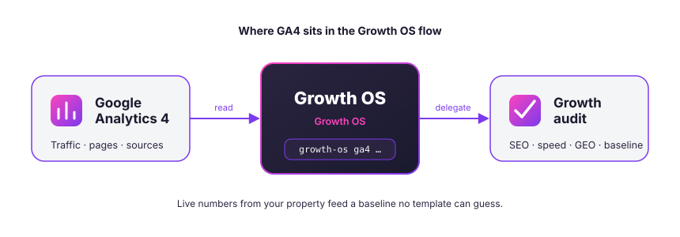
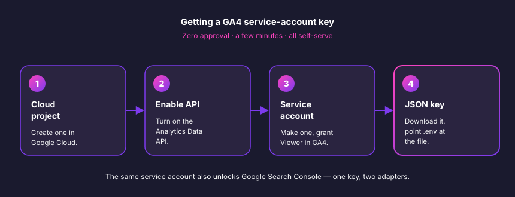

# Connect Google Analytics 4

**What Growth OS reads here:** your live traffic, top pages, acquisition sources, and conversion events — the real baseline numbers that make a growth audit specific to *your* site instead of generic advice.



GA4 is the first thing I recommend connecting. It's **zero-approval** (no waiting on Google to review anything), it takes a few minutes, and the same key you create here also unlocks Google Search Console later.

---

## Prerequisites

- A website with Google Analytics 4 already collecting data (if you're on the old Universal Analytics, you'll need to migrate first — GA4 is the only version the Data API serves).
- A Google account with **Admin** or **Editor** access to that GA4 property.
- A Google Cloud account (free tier is fine — the Data API has a generous free quota).
- Growth OS installed and a `.env` file in your project root.

---

## Step 1 — Find your GA4 property

Open [analytics.google.com](https://analytics.google.com) and make sure you're looking at a **GA4 property** (not a Universal Analytics one). GA4 properties show an **Admin** gear in the bottom-left and report on *events*, not *sessions-only* views.

If you have several properties, pick the one that tracks the site you want Growth OS to audit. You'll wire that specific property to Growth OS — not your whole account.

## Step 2 — Copy the Property ID

In **Admin → Property → Property details** (or **Property Settings**), copy the **Property ID**. It's a plain number, something like `398745210` — **not** the `G-XXXXXXX` measurement ID you paste into your site's tracking snippet. Those two get confused constantly; Growth OS needs the numeric one.

Keep it handy — it goes into `.env` in a moment.

## Step 3 — Create a service account and grant it access

A *service account* is a robot Google identity Growth OS authenticates as. This is the cleanest path: no browser OAuth dance, no tokens that expire, and you can revoke it in one click later.



1. **Create a Google Cloud project.** Go to [console.cloud.google.com](https://console.cloud.google.com), open the project picker at the top, and create a new project (call it `growth-os` or reuse an existing one).

2. **Enable the Analytics Data API.** In the search bar type *"Google Analytics Data API"*, open it, and click **Enable**. (This is the `analyticsdata.googleapis.com` API — the one that serves report data. Enabling it is free.)

3. **Create the service account.** Go to **APIs & Services → Credentials → Create credentials → Service account**. Give it a name like `growth-os-reader`, skip the optional role grants (it doesn't need any project-level IAM role — access is granted inside GA4 instead), and click **Done**.

4. **Grab the service-account email.** It looks like `growth-os-reader@your-project.iam.gserviceaccount.com`. Copy it.

5. **Add that email as a Viewer in GA4.** Back in Google Analytics: **Admin → Property → Property Access Management → +  → Add users**. Paste the service-account email, set the role to **Viewer**, uncheck *"Notify new users by email"* (robots don't read email), and save.

6. **Download the JSON key.** In Cloud Console, open the service account → **Keys → Add key → Create new key → JSON**. A `.json` file downloads. Treat it like a password — anyone with this file can read your analytics. Move it somewhere sensible, e.g. `~/.growth-os/ga4-key.json`, and keep it out of git.

## Paste it into `.env`

Add these two lines to the `.env` in your project root:

```bash
# Google Analytics 4
GA4_PROPERTY_ID=398745210
GOOGLE_APPLICATION_CREDENTIALS=/Users/you/.growth-os/ga4-key.json
```

`GOOGLE_APPLICATION_CREDENTIALS` is an absolute path to the JSON file you just downloaded — **not** the file's contents. Make sure `.env` and the key file are both in your `.gitignore`.

> Reusing this key for Search Console? The same service account works — you just add its email to your GSC property too. See [`gsc.md`](./gsc.md).

## Verify

Run the built-in check:

```bash
growth-os ga4 verify
```

You should see your property name and a small sample of the last 7 days — something like:

```
✓ GA4 connected — property "nocodework.io" (398745210)
  Users (7d): 1,284   Sessions: 1,910   Top page: /  (412 views)
```

Once that passes, try a real pull:

```bash
growth-os ga4 top-pages --days 28
growth-os ga4 sources --days 28
```

Or just let the orchestrator use it — `/growth-os:audit` will read GA4 automatically once it's connected.

---

## Troubleshooting

**`403 PERMISSION_DENIED` / "User does not have sufficient permissions for this property"**
The service-account email isn't a Viewer on the property yet, or you added it to the wrong property. Re-check Step 3.5 — the email in GA4 access management must exactly match the `client_email` field inside your JSON key.

**`403` mentioning the API is disabled**
The Analytics Data API isn't enabled on the *same* Cloud project the key belongs to. Confirm the project name in Cloud Console matches, then redo Step 3.2.

**`Property ID ... not found` or empty results**
You probably used the `G-XXXXXXX` measurement ID instead of the numeric Property ID. Go back to Step 2 and copy the number from Property details.

**`FileNotFoundError` / "Could not automatically determine credentials"**
`GOOGLE_APPLICATION_CREDENTIALS` points at a path that doesn't exist. Use an absolute path and check for typos or a stray trailing space.

**Data looks partial or a day behind**
GA4 processes data with some latency, and very recent events may not be final for 24–48h. For audits, Growth OS defaults to windows that end a day or two back to avoid reporting on half-processed days.

**Still stuck?** Open an issue at [github.com/nocodework/growth-os](https://github.com/nocodework/growth-os) with the command you ran and the error (redact the property ID if you like). Never paste the contents of your JSON key.
