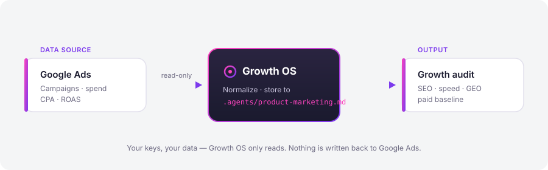
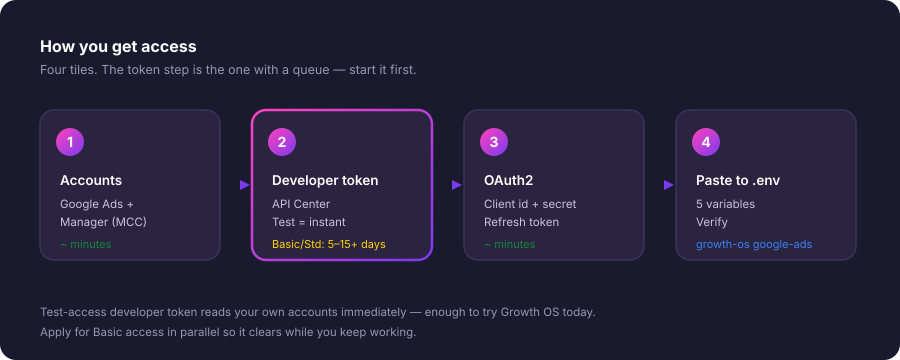

# Google Ads 🔴

Growth OS reads your Google Ads campaigns, spend, and conversion metrics (CPA, ROAS, click and impression trends) so the growth audit can put a real number on what paid is doing — instead of guessing.



> **Heads up — this one has a lead-time.** Google Ads is the one v1 integration that isn't zero-approval. You need a *developer token*, and unless you use the instant **Test** access level, Google reviews your application (typically 5–15+ days). Nothing else here is hard, but start Step 2 first so the queue clears while you finish everything else.

---

## Prerequisites

- A Google account you can use to sign in.
- A Google Cloud project (free — you'll create OAuth credentials in it).
- 15–20 minutes of hands-on time. The rest is Google's review clock.
- Growth OS installed and a `.env` file in your project root (see the main README).

---

## Step 1 — Create a Google Ads account + a Manager (MCC) account

The Google Ads API can only be reached through a **Manager account** (also called MCC — My Client Center). The developer token you'll request in Step 2 is issued *to the manager account*, not to a regular ad account.

1. If you don't already advertise, create a standard Google Ads account at [ads.google.com](https://ads.google.com). You do **not** need to launch a campaign or spend money to read data later.
2. Create a Manager account at [ads.google.com/home/tools/manager-accounts](https://ads.google.com/home/tools/manager-accounts).
3. From inside the manager account, **link** the ad account(s) you want Growth OS to read. Sub-account → *Accounts* → link by customer ID, or accept the invite from the child account.

Write down two IDs — you'll need them later:

- **Manager account ID** (the MCC, 10 digits like `123-456-7890`) → this becomes your `login_customer_id`.
- **Ad account customer ID** (the account whose data you actually want) → this is the `customer_id` you'll query.

---

## Step 2 — Apply for a developer token (do this FIRST)

The developer token authorizes API calls. Get it from the manager account's API Center: **Tools → API Center** (or [ads.google.com](https://ads.google.com) → *Admin* → *API Center*).



There are three access levels, and the difference matters a lot for how fast you can start:

| Access level | What it reads | Approval |
|---|---|---|
| 🟢 **Test** | Only *test accounts* — but a Test token works **instantly**, no review | Immediate |
| 🟡 **Basic** | Your **real** production accounts, standard daily quotas | Review, usually **5–15+ days** |
| 🔵 **Standard** | Real accounts, high volume | Review, longest |

**What we recommend:**

- Fill in the API Center application now to get your token string. It's issued immediately at **Test** level.
- On the same screen, **submit the Basic access application** right away. This is the part with the queue. Google emails you when it's approved.
- While you wait for Basic, you can wire everything up and verify the pipeline against a test account. When Basic lands, the *same* token flips to reading your live accounts — no code changes.

> The application asks how you'll use the API. Be honest and concrete: read-only reporting on your own/managed accounts, no ad creation, no third-party redistribution. Vague answers are the most common reason applications get bounced.

Copy the token — it looks like a random alphanumeric string.

---

## Step 3 — Set up OAuth2 and generate a refresh token

The developer token says *"this app may use the API."* OAuth2 says *"this specific user grants access to their accounts."* You need both.

**3a. Create OAuth credentials in Google Cloud**

1. Go to [console.cloud.google.com](https://console.cloud.google.com) → pick (or create) a project.
2. **APIs & Services → Library** → enable the **Google Ads API**.
3. **APIs & Services → OAuth consent screen** → configure it. For personal use, set it to **External**, add yourself as a **Test user**, and you can leave it in *Testing* mode.
4. **APIs & Services → Credentials → Create credentials → OAuth client ID** → application type **Desktop app**.
5. Copy the **Client ID** and **Client secret**.

**3b. Exchange consent for a refresh token**

You need a one-time browser consent to mint a long-lived refresh token. Run the Growth OS helper:

```bash
growth-os google-ads auth
```

It opens a Google consent screen, you approve read-only access with the account that owns/manages your ad accounts, and it prints a **refresh token**. Copy it.

> Prefer to do it by hand? Google's OAuth Playground works too — authorize the scope `https://www.googleapis.com/auth/adwords`, then exchange the code for a refresh token. The `growth-os google-ads auth` command just automates exactly that.

**3c. Confirm your `login_customer_id`**

This is the **Manager (MCC) account ID from Step 1, with the dashes removed** — e.g. `123-456-7890` becomes `1234567890`. Growth OS sends it as the `login-customer-id` header so Google knows which manager account is making the call.

---

## Paste to `.env`

Add these five values to the `.env` in your project root:

```dotenv
# Google Ads (read-side)
GOOGLE_ADS_DEVELOPER_TOKEN=your_developer_token
GOOGLE_ADS_CLIENT_ID=xxxxxxxx.apps.googleusercontent.com
GOOGLE_ADS_CLIENT_SECRET=your_client_secret
GOOGLE_ADS_REFRESH_TOKEN=your_refresh_token
GOOGLE_ADS_LOGIN_CUSTOMER_ID=1234567890   # MCC id, no dashes
```

`.env` is gitignored by default — your keys stay on your machine. Growth OS never sends them anywhere but Google.

---

## Verify

Point Growth OS at the ad account you want to read (customer ID from Step 1, dashes removed):

```bash
growth-os google-ads accounts
# → lists every account your token can reach

growth-os google-ads campaigns --customer 9876543210 --days 30
# → campaign name · cost · clicks · conversions · CPA · ROAS (last 30 days)
```

If you see rows, you're connected. Growth OS will now pull this into the paid-baseline section of `/growth-os:audit`.

---

## Troubleshooting

**`DEVELOPER_TOKEN_NOT_APPROVED` / can only see test accounts**
Your token is still at **Test** level. Real-account data needs **Basic** access approved (Step 2). Check the API Center for status, or your inbox for Google's email.

**`AUTHENTICATION_ERROR` / `invalid_grant`**
The refresh token is wrong, revoked, or was minted with the wrong Google user. Re-run `growth-os google-ads auth` and approve with the account that *manages* the ad accounts.

**`USER_PERMISSION_DENIED`**
The authenticated user can see the *manager* account but not the *child* account you're querying, or the child isn't linked. Re-check the account link in Step 1.

**`login-customer-id` errors / `CUSTOMER_NOT_ENABLED`**
`GOOGLE_ADS_LOGIN_CUSTOMER_ID` must be the **manager** account ID with **no dashes**. A regular ad account ID here won't work.

**`developer token is not associated with...`**
The developer token was issued by a *different* manager account than the one in `login_customer_id`. They must match — the token belongs to the MCC.

**Everything's set but numbers look empty**
A brand-new or paused account genuinely has no spend in the window. Widen `--days`, or verify you're querying the ad account (child), not the manager.

---

← Back to [all integrations](../../README.md#what-it-connects-to) · Next zero-approval source: [GA4](./ga4.md)
