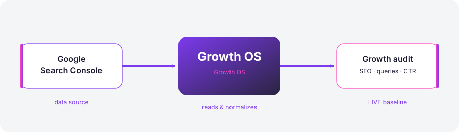
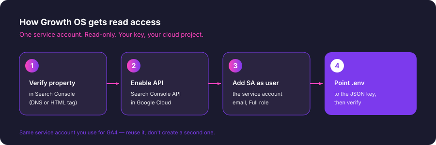

# Google Search Console

Growth OS reads your **search performance** from Google Search Console — the exact queries people typed to find you, plus impressions, clicks, average position, and CTR per page. This is the ground truth behind every SEO and GEO recommendation Growth OS makes: it audits against what you *actually* rank for, not what a keyword tool guesses.



The good news: if you already connected GA4 to Growth OS, you're 90% done. Search Console uses the **same Google Cloud service account** — you just enable one more API and add the account as a user on your property. No second key, no OAuth dance.

---

## Prerequisites

- A **verified property** in Search Console for the site you want to audit. Verification is a one-time thing (see Step 1) and it's free.
- A **Google Cloud project** with a **service account** and its JSON key file. If you set up GA4 for Growth OS, you already have this — reuse it. If not, create one: Cloud Console → *IAM & Admin* → *Service Accounts* → *Create service account* → *Keys* → *Add key* → *JSON*.
- The service account's **email address** (it looks like `growth-os-reader@your-project.iam.gserviceaccount.com`). You'll paste this into Search Console in Step 3.
- A shell where you can run `growth-os`. Read-only scope throughout — Growth OS never writes to your property.

---

## Step 1 — Verify your site in Search Console

If your site already shows up at [search.google.com/search-console](https://search.google.com/search-console), skip to Step 2.

Otherwise, add and verify it. Two verification methods work well:

- **DNS verification** (recommended) — Search Console gives you a `TXT` record. Add it at your DNS provider (Cloudflare, GoDaddy, etc.), wait a few minutes, click *Verify*. This method covers your whole domain, subdomains and `http`/`https` included.
- **HTML tag / file** — drop a `<meta>` tag in your `<head>` or upload an HTML file to your web root. Faster if you can't touch DNS, but it only verifies that one exact URL prefix.

DNS is the one to pick if you have the choice — it makes Step 2 simpler.

---

## Step 2 — Know which property you're pointing at

This is where people trip. Search Console has **two property types**, and the identifier you give Growth OS must match exactly:

| Property type | Identifier format | What it covers |
|---|---|---|
| **Domain** | `sc-domain:nocodework.io` | All subdomains + `http` + `https`, one bucket |
| **URL-prefix** | `https://nocodework.io/` | Only that exact scheme + host + path |

A **Domain** property (from DNS verification) uses the `sc-domain:` prefix — note there's **no** `https://` and **no** trailing slash. A **URL-prefix** property is the full URL *with* the trailing slash.

Get it wrong and the API returns an empty result set, not an error — so it looks like you have no traffic when you actually have a typo. Open Search Console, look at the property picker in the top-left, and copy the identifier verbatim. That string goes into `.env` below.

---

## Step 3 — Enable the API and add the service account as a user

Two small things, both one-time.



**a) Enable the Search Console API.** In the same Google Cloud project as your service account, go to *APIs & Services* → *Library*, search for **Google Search Console API**, and click **Enable**. (If GA4 already works, you enabled the *Analytics* API here before — this is the sibling for Search Console.)

**b) Grant the service account access to the property.** The service account is a "person" as far as Search Console is concerned, so you invite it like any teammate:

1. Open [Search Console](https://search.google.com/search-console) → your property → *Settings* → *Users and permissions*.
2. Click **Add user**.
3. Paste the service account **email** (`...iam.gserviceaccount.com`).
4. Set permission to **Full** (Growth OS only reads, but the Search Analytics API rejects the *Restricted* role for some report types — Full is the safe choice and still read-only in practice).
5. Save.

That's it. No email confirmation to click; service accounts are added instantly.

---

## Paste to `.env`

Add these to the `.env` file in your Growth OS project root:

```bash
# --- Google Search Console ---
# Reuse the SAME service account JSON you use for GA4.
GSC_SERVICE_ACCOUNT_JSON=/absolute/path/to/service-account.json

# The property identifier, copied EXACTLY from Step 2.
# Domain property:
GSC_SITE_URL=sc-domain:nocodework.io
# ...or URL-prefix property (mutually exclusive — pick one):
# GSC_SITE_URL=https://nocodework.io/
```

> `.env` is gitignored by default in Growth OS. The JSON key stays on your machine (or your own server). Growth OS has no telemetry and never uploads your credentials anywhere.

---

## Verify

Run the built-in connection check:

```bash
growth-os gsc verify
```

You should see something like:

```
✓ Service account loaded: growth-os-reader@your-project.iam.gserviceaccount.com
✓ Search Console API reachable
✓ Property sc-domain:nocodework.io accessible
✓ Pulled 28 days of data — 1,204 queries, 14,880 clicks
```

Then pull a real report to confirm the data looks right:

```bash
growth-os gsc queries --days 28 --limit 10
```

This prints your top queries by clicks, with impressions, CTR, and average position. Once this returns your actual search terms, Search Console is wired in — `/growth-os:audit` and `/growth-os:context` will start using it automatically.

---

## Troubleshooting

**`403 User does not have sufficient permission` (or `PERMISSION_DENIED`)**
The service account isn't a user on the property yet, or you added it to a *different* property than the one in `GSC_SITE_URL`. Re-check Step 3b, and confirm the property identifier matches Step 2 exactly.

**Empty results, but no error**
Almost always a property-string mismatch. `sc-domain:nocodework.io` and `https://nocodework.io/` are *different properties* to Google. Copy the identifier straight from the Search Console property picker. Also note: Search Console data has a **2–3 day lag**, so a brand-new property or a very short `--days` window can legitimately be empty.

**`403 ... has not been used in project ... or it is disabled`**
The Search Console API isn't enabled in that Cloud project. Do Step 3a. Enabling it can take a minute or two to propagate.

**`FileNotFoundError` / `could not load credentials`**
`GSC_SERVICE_ACCOUNT_JSON` must be an **absolute** path to the JSON key file, and the file has to be readable by your user. Relative paths break when Growth OS runs from a different working directory.

**Data doesn't match the Search Console UI exactly**
Expected. The API and the UI sometimes sample or round differently, and the UI defaults to a different date range. For audit purposes the trends and rankings are what matter, and those line up.

---

*Next: connect [Google Analytics 4](./google-analytics-4.md) for traffic and conversions, or run `/growth-os:audit` now if GSC is your first source.*
