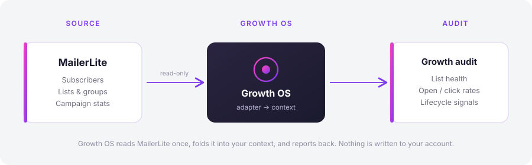
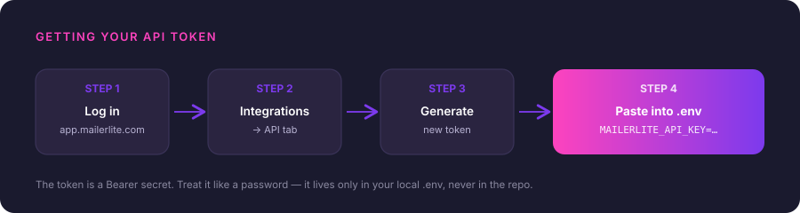

# MailerLite

Growth OS reads your **lists, subscribers, and campaign stats** from MailerLite so it can factor email health — list growth, open and click rates, lifecycle signals — into your growth audit. It never writes to your account, sends anything, or touches a subscriber.

This is the easiest integration to set up. It's a single API key, no OAuth dance, no approvals. If you've never connected an account to Growth OS before, start here.



---

## Prerequisites

- A MailerLite account (the free plan works — it exposes the API).
- Access to that account's **Integrations** settings. On MailerLite you need to be an account owner or an admin to mint an API token.
- A Growth OS checkout with a `.env` file at the repo root (copy `.env.example` if you haven't yet).

That's it. No billing details, no verification wait, no developer program. You can be done in under two minutes.

---

## Step 1 — Log in to MailerLite

Go to [app.mailerlite.com](https://app.mailerlite.com) and sign in.

> **Which MailerLite?** There are two generations of the product: **MailerLite** (the current app, `app.mailerlite.com`) and **MailerLite Classic** (`classic.mailerlite.com`). Growth OS targets the current app's API. If your dashboard URL says `classic`, the token screen looks different — the section below assumes the current app.

## Step 2 — Open Integrations → API

1. Click your account name / avatar in the bottom-left corner.
2. Choose **Integrations** from the menu.
3. Find the **API** panel and click **Use** (or **Manage**).

You'll land on the API tokens screen. If you've made tokens before, they're listed here (the secret is masked — MailerLite only shows the full value once, at creation).



## Step 3 — Generate a token

1. Click **Generate new token**.
2. Give it a name you'll recognize later — `growth-os` is a fine choice.
3. Copy the token **immediately**. MailerLite shows the full value exactly once. If you navigate away without copying it, you'll have to delete it and generate a new one.

The token is a long opaque string. It's a **Bearer** credential — Growth OS sends it as `Authorization: Bearer <token>` on every request.

## Step 4 — Paste it into `.env`

Open the `.env` file at the root of your Growth OS checkout and add:

```dotenv
MAILERLITE_API_KEY=your-token-goes-here
```

Save the file. `.env` is git-ignored by default in Growth OS — the token stays on your machine and never rides along in a commit. If you're wiring Growth OS into CI or a self-hosted runtime, set the same variable as an environment secret instead of committing it.

## Step 5 — Verify

Confirm Growth OS can reach MailerLite with your key:

```bash
growth-os mailerlite verify
```

A healthy connection prints your account name and a quick summary — something like:

```
✓ MailerLite connected
  Account:      Acme Newsletter
  Subscribers:  4,812 active · 133 unsubscribed
  Lists/groups: 6
```

To pull the same data Growth OS uses in an audit, run:

```bash
growth-os mailerlite lists          # every list/group with subscriber counts
growth-os mailerlite campaigns      # recent campaigns with open & click rates
growth-os mailerlite subscribers    # subscriber totals and status breakdown
```

Once `verify` passes, the `/growth-os:audit` and `/growth-os:dashboard` commands will pick up MailerLite automatically — no extra flags.

---

## Troubleshooting

**`401 Unauthorized` / "Invalid API token"**
The key is wrong, truncated, or from MailerLite Classic. Re-copy it from Step 3 (watch for a leading/trailing space), and confirm you generated it in the current app rather than Classic. If in doubt, delete the token and mint a fresh one.

**`403 Forbidden`**
Your MailerLite plan or role doesn't expose the endpoint Growth OS asked for. Confirm you're an owner/admin and that API access is enabled for your account tier.

**`429 Too Many Requests`**
MailerLite rate-limits the API. Growth OS backs off and retries, but if you're running several commands back-to-back, give it a minute and try again.

**`verify` says "MAILERLITE_API_KEY not set"**
Growth OS didn't find the variable. Check that `.env` sits at the repo root, that the line reads exactly `MAILERLITE_API_KEY=...` with no quotes or spaces around the `=`, and that you saved the file. If you exported it in your shell instead, make sure you're running Growth OS from that same shell.

**Numbers look stale**
Growth OS reads live from the API on each run — there's no cache to clear. If a campaign you just sent isn't showing, MailerLite may not have finalized its stats yet; recently-sent campaigns can take a little while to report opens and clicks.

---

**Rotating or revoking:** Delete the token from the same Integrations → API screen at any time. Growth OS stops having access the moment you do. Generate a new one and update `.env` to rotate.

← Back to [all integrations](../integrations/) · [Growth OS README](../../README.md)
