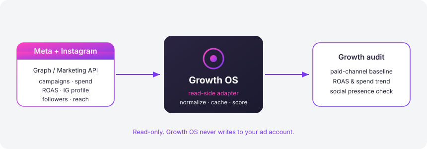
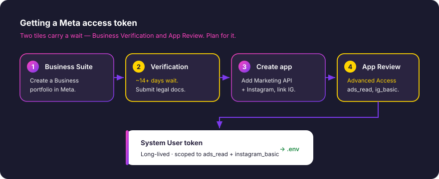

# Connect Meta Marketing (Graph) + Instagram

🔴 **Approval with lead time — start this early.**

Once connected, Growth OS reads your paid social from the Meta Graph / Marketing API: campaign spend, impressions, clicks, CPC, and ROAS across Facebook and Instagram, plus the public state of your linked Instagram Business account (followers, reach, media count). It uses this to build the paid-channel section of your growth audit and to sanity-check your social presence. Growth OS is strictly read-side — it never creates, edits, or pauses a campaign, and it never posts to Instagram.



This is the slowest integration to switch on, and almost none of the wait is your keyboard. Meta gates ad data behind **Business Verification** and **App Review**, and both are queues you submit to and then wait on. If you only do one thing today, start Business Verification (Step 1) and come back for the rest while it processes.

---

## Prerequisites

- A Facebook account that is an admin of the Facebook Page you advertise from.
- An **Instagram Business** (or Creator) account, linked to that Page. Personal Instagram accounts are not readable through the Marketing API.
- At least one active or historical ad campaign — otherwise there is nothing for Growth OS to report.
- Company legal details for verification: legal business name, address, and a document that proves them (certificate of incorporation, business license, tax/VAT registration, or a utility bill in the business name). Have these as clean PDFs or photos before you start.
- Growth OS installed and your `.env` file created (copy `.env.example` if you haven't).

---

## Step 1 — Create a Meta Business portfolio and start Business Verification

> ⏳ **This is the bottleneck. Budget ~14+ days, sometimes longer.** Verification does not fail loudly — it stalls on document mismatches. Get it moving before anything else.

1. Go to **[business.facebook.com](https://business.facebook.com/)** and create a Business portfolio (formerly "Business Manager") if you don't already have one. Enter your legal business name exactly as it appears on your documents — a mismatch here is the single most common reason verification stalls.
2. Open **Business Settings → Business Info → Security Center** (Meta moves this around; also search "verification" in settings).
3. Start **Business Verification**. You'll confirm:
   - Legal business name, address, and phone number.
   - Ownership, by uploading one of the accepted documents listed in the prerequisites.
   - Domain and phone, sometimes via a code sent to a business number or email.
4. Submit and note the date. Status lives under Security Center.

**Why it stalls, and how to avoid it:**

- The name, address, and phone on your documents must match your Business portfolio **character for character**. "Ltd" vs "Limited", a missing suite number, or an old address will bounce it.
- Blurry scans and cropped edges get rejected. Send full-page, legible files.
- A public phone number and website that match your documents speed the review noticeably.

Move on to Step 2 while this processes — you can build the app in parallel and only need verification approved before requesting Advanced Access in Step 3.

---

## Step 2 — Create an app, add Marketing API + Instagram, and link your IG account

1. Go to **[developers.facebook.com/apps](https://developers.facebook.com/apps/)** → **Create App**.
2. Choose the **Business** app type and attach it to the Business portfolio from Step 1.
3. On the app dashboard, add products:
   - **Marketing API** — this is what exposes campaign, ad set, and ad insights.
   - **Instagram** (Instagram Graph API) — for the linked IG Business account's profile and media metrics.
4. Confirm your Facebook Page is connected to your Instagram Business account: **Instagram app → Settings → Linked accounts**, or on the Page itself under **Linked accounts**. Growth OS reads Instagram *through* this Page connection, so if the link is missing, Instagram data will be empty even when everything else works.
5. From **Settings → Basic**, copy your **App ID** and **App Secret**. You'll paste these into `.env` shortly.

---

## Step 3 — Create a System User and mint a scoped token

A **System User** token is the right credential for automation: it's tied to your business, not to a person's login, and it doesn't expire when someone leaves or changes their password.



1. In **Business Settings → Users → System Users**, click **Add**, name it something like `growth-os-read`, and give it the **Employee** role.
2. Assign assets to the System User: the **ad account(s)** and the **Page** whose Instagram you want to read. Grant **read** access — nothing more. Growth OS never needs write or manage permissions.
3. Click **Generate token**, select your app from Step 2, and request these scopes:
   - `ads_read` — campaign and ad insights (spend, ROAS, impressions, clicks).
   - `instagram_basic` — the linked Instagram account's profile and media.
   - `read_insights` — optional, for richer Page/IG reach and engagement metrics.
4. Copy the token immediately. Meta shows a System User token **once**; if you lose it, you regenerate.

> 🔑 **Advanced Access needs App Review.** With verification done, your app starts in **Standard Access**, which only returns data for people with a role on the app — fine for testing against your own accounts. To read at full scope reliably, submit `ads_read` and `instagram_basic` for **Advanced Access** under **App Review → Permissions and Features**. Each request wants a short written use case ("read our own ad and Instagram metrics into an internal analytics tool") and often a screencast. This review typically takes a few business days. For a solo test against your own ad account, Standard Access is usually enough to see data flowing.

---

## Paste to `.env`

Add these to your Growth OS `.env` (never commit this file — it's already in `.gitignore`):

```dotenv
# Meta Marketing (Graph) + Instagram
META_APP_ID=1234567890123456
META_APP_SECRET=your_app_secret_here
META_SYSTEM_USER_TOKEN=EAAG...your_long_lived_token
META_AD_ACCOUNT_ID=act_1234567890        # note the act_ prefix
META_IG_USER_ID=17841400000000000    # optional; Growth OS can resolve it from the Page
META_GRAPH_API_VERSION=v21.0             # optional; defaults to the current stable version
```

- `META_AD_ACCOUNT_ID` must include the `act_` prefix. Find it in Ads Manager or Business Settings → Accounts → Ad accounts.
- `META_IG_USER_ID` is optional. If you leave it blank, Growth OS resolves the Instagram Business ID from the Page linked to your token.

---

## Verify

With the values in place, confirm Growth OS can read your account:

```bash
growth-os meta verify
```

A healthy connection prints something like:

```
✓ Token valid — System User: growth-os-read
✓ Ad account act_1234567890 — 3 active campaigns, last 28 days
✓ Instagram business @yourbrand — 12,480 followers
Meta + Instagram: connected.
```

Then pull a quick snapshot to see real numbers:

```bash
growth-os meta spend --days 30      # spend, impressions, clicks, ROAS by campaign
growth-os meta instagram            # follower count, reach, recent media
```

---

## Troubleshooting

**`(#200) Requires ads_read permission` or empty campaign data.**
Your token is missing `ads_read`, or you're on Standard Access and the ad account has no app-role user. Regenerate the token with the scope (Step 3), or submit `ads_read` for Advanced Access via App Review.

**`(#10) Application does not have permission for this action`.**
The System User isn't assigned to the ad account, or was assigned view-only on the wrong asset. Re-check **System Users → Assigned assets** and confirm the correct `act_...` account is attached.

**Instagram section is empty but Facebook data works.**
The Page and Instagram Business account aren't linked, or the account is a personal (not Business/Creator) profile. Fix the link in Step 2, then re-run `growth-os meta verify`. Also confirm `instagram_basic` is on the token.

**`Error validating access token: Session has expired`.**
You used a short-lived user token instead of a System User token. Go back to Step 3 and generate a token from **System Users** — those are long-lived by default.

**Verification has been "pending" for weeks.**
Open Security Center and look for a request for more info — Meta often asks silently. The usual culprit is a document that doesn't match your Business portfolio's legal name or address exactly. Correct the mismatch and resubmit.

**`(#4) Application request limit reached`.**
You're rate-limited. Growth OS caches reads, but during setup you may hit the limit by re-running commands quickly. Wait a few minutes and retry; for large accounts, narrow the window with `--days`.

---

← Back to [all integrations](../../README.md#what-it-connects-to) · Next up, the 🟢 zero-approval sources ([GA4](./ga4.md), [Search Console](./search-console.md), [MailerLite](./mailerlite.md)) connect in minutes.
